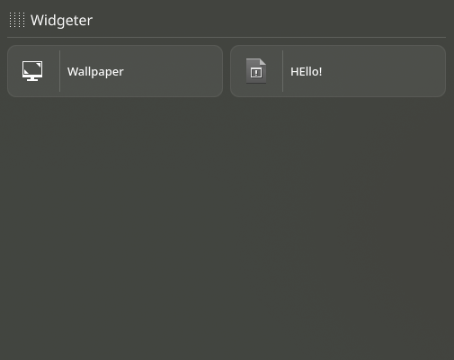

# Widgeter



A customizable quick-launch popup menu widget for **KDE Plasma 6**. **Widgeter** displays a clean, card-based launcher grid allowing you to execute custom Bash commands and launch applications with distinct icons and labels.

---

## Features

- **Custom Quick-Launch Cards**:
  - Add, remove, and reorder custom launcher cards.
  - Set custom display labels for each card.
  - Choose icons from system icon themes or pick local image files (`.png`, `.svg`, `.jpg`, `.webp`).
  - Assign custom Bash commands (e.g., launching apps or executing shell commands).
- **Flexible Grid Layout**:
  - Switch between **1 column** (wide cards) and **2 columns** (compact two-per-row grid) layouts.
- **Customizable Panel Icon**:
  - Set the panel button icon using system icon picker, custom image file path, or manual icon name.
  - Reset to default icon with one click.
- **Native Look & Feel**:
  - Built with Kirigami and Plasma components adhering to your active KDE color scheme and theme.
  - Smooth hover animations and visual feedback.
  - Automatic popup close on launch with delayed command execution.

---

## Installation

### Requirements
- **KDE Plasma 6**
- `kpackagetool6`

---

### Method 1: Install from Project Source Directory

1. Open your terminal in the `Widgeter` repository folder.
2. Install the widget using `kpackagetool6`:
   ```bash
   kpackagetool6 -t Plasma/Applet -i .
   ```

3. **To update** after modifying or pulling new changes:
   ```bash
   kpackagetool6 -t Plasma/Applet -u .
   ```

4. If Plasma doesn't reload the applet immediately, restart Plasma shell or log out and back in:
   ```bash
   qdbus org.kde.KWin /KWin reconfigure
   plasmashell --replace &
   ```

---

### Method 2: Install via `.plasmoid` Package

1. Package the widget into a `.plasmoid` zip archive:
   ```bash
   zip -r Widgeter.plasmoid metadata.json contents/
   ```
2. Open **System Settings** or right-click your desktop / panel and select **Add Widgets…**
3. Click **Get New Widgets** (or **Install from File…** in Plasma settings).
4. Select **Install from local file…**, choose `Widgeter.plasmoid`, and confirm installation.

---

## Configuration

Right-click the widget icon on your panel and select **Configure Widgeter…**:

- **General**:
  - **Icon**: Choose the icon displayed on your Plasma panel.
  - **Grid layout**: Choose between `1 column (wide cards)` or `2 columns (two per row)`.
- **Cards Configuration**:
  - Click **Add Card** to create a new card.
  - Reorder cards using the **Up** / **Down** arrow buttons.
  - Delete cards using the **Delete** button.
  - Set custom **Label**, **Icon**, and **Command** for each card.

---

## License

GPL-3.0 or later
